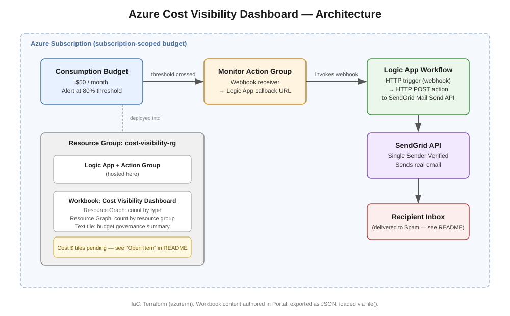

# Azure Cost Visibility Dashboard

A FinOps-adjacent tooling project: a subscription-wide budget with a custom
alerting pipeline (Budget → Action Group → Logic App → SendGrid email) and a
Workbook dashboard, all provisioned via Terraform.

> **Status: in progress.** The architecture, alerting pipeline, and dashboard
> are built and working end-to-end. This project is not considered complete
> until the Workbook can show real cost figures (currently blocked by a
> genuine Cost Management API / new-subscription limitation — see
> [Open Item](#open-item--real-cost-data) below). Everything else described
> here is fully built and verified.

---

## Architecture



**Flow:** A subscription-wide Consumption Budget ($50/month, 80% threshold)
notifies a Monitor Action Group when crossed. The Action Group calls a Logic
App via webhook, which makes an HTTP POST directly to SendGrid's Mail Send
API — composing and sending a custom alert email, rather than relying on
Azure's plain built-in budget email. A Workbook dashboard, built from Azure
Resource Graph queries plus a static governance-summary tile, visualizes
what's deployed and the budget's configuration.

---

## Why Logic App + SendGrid instead of the built-in budget email

Azure budgets can email directly with no extra infrastructure — but that
email is fixed-format and not customizable. Routing through an Action Group
→ Logic App → SendGrid instead means the actual email content (subject,
body, and potentially richer formatting or multi-channel delivery later) is
fully controlled in code, which is the realistic pattern for any
organization that wants alerts to look like *their* notifications rather
than Azure's generic template.

---

## Why Terraform + hand-authored JSON, not pure HCL

Budgets, Action Groups, and the Logic App/Workbook *shells* map cleanly to
Terraform resources. The actual **content** of a Logic App's workflow and a
Workbook's tiles are both large, deeply nested JSON documents that are
genuinely painful to express as HCL object literals. The practical,
realistic pattern — used here — is: author that content visually in the
Azure Portal, export the resulting JSON, and have Terraform load it via
`file(...)` rather than hand-writing the JSON as nested HCL.

---

## Repo Structure

```
azure-cost-visibility-dashboard/
├── terraform/
│   ├── main.tf                # providers (azurerm, random)
│   ├── variables.tf
│   ├── terraform.tfvars.example
│   ├── budget.tf
│   ├── action-group.tf
│   ├── logic-app.tf           # resource group, Logic App, trigger, action
│   ├── workbook.tf
│   └── outputs.tf
├── workbook/
│   └── workbook-content.json  # exported from the Portal's Advanced Editor
├── docs/
│   └── architecture-diagram.svg
└── README.md
```

---

## What's Actually Working (Verified)

- **Budget** — subscription-wide, $50/month, 80% threshold, notifying via
  `contact_groups` (the Action Group), not the plain built-in email
- **Action Group → Logic App webhook** — confirmed firing correctly via a
  direct manual POST to the trigger's callback URL
- **Logic App → SendGrid → real email delivered** — confirmed with an
  actual received email, subject "Cost Alert Triggered," body matching the
  Terraform-defined content exactly
- **Workbook dashboard** — two Resource Graph query tiles (resource count by
  type, resource count by resource group) and a text tile with the budget's
  governance facts, all rendering real, live data

---

## Open Item — Real Cost Data

The Workbook currently shows resource inventory, not dollar figures. This
was a deliberate pivot, not an oversight — documented in full below.

### What was attempted
A Workbook tile querying Cost Management's Query API directly
(`Microsoft.CostManagement/query`, `ActualCost`, `MonthToDate`, grouped by
resource group) — the natural, correct way to show real spend in a
Workbook.

### What happened
The query consistently returned `429 Too Many Requests`, even after:
- Confirming ample request quota remained (`1099` requests remaining per
  the `x-ms-ratelimit-remaining-subscription-resource-requests` header)
- Confirming no active Azure service health issues
- Testing with a minimal, simplified query body
- Testing in full isolation (closed Portal tabs, spaced-out retries)
- Testing identically via both the Workbook UI and direct `az rest` calls

### Root cause
The Azure Portal's own native Cost Management → Cost analysis view showed
**"No cost reported during this period"** for the subscription. This is a
**brand-new subscription with no billing history at all.** The Query API
appears to handle this edge case poorly — producing a persistent, confusing
429 rather than a clean empty result — rather than this being a genuine
quota or configuration problem. This is consistent with reports from other
users that Cost Management's Query API is one of the more operationally
fragile APIs in Azure, particularly for low-activity or brand-new
subscriptions.

### Current plan to resolve
Cost Management's billing pipeline needs real usage data to report on, and
new-subscription cost data can take time to initialize even once resources
begin accruing charges (and separately, actual usage data commonly takes
24–48 hours to appear in Cost Management after being incurred, regardless
of subscription age). This project will be revisited once the subscription
has enough real billing history for the Cost Management query to return
meaningful data — at which point the original ARM-based query tile will be
reattempted and, if successful, will replace or supplement the current
Resource Graph tiles.

---

## Other Real Issues Hit Along the Way

- **`jsonencode()` nesting discipline** — every value passed into
  `jsonencode({...})` must be written as plain HCL (`key = value`), never
  JSON syntax (`"key": value`) — mixing the two, or nesting a second
  `jsonencode()` call inside an outer one, produces either syntax errors or
  silently double-encoded strings instead of proper nested JSON.
- **SendGrid deliverability** — using Single Sender Verification (rather
  than full domain authentication, which requires owning a custom domain)
  means outbound mail carries no SPF/DKIM/DMARC alignment for the sending
  address, and reliably lands in spam on first send. This is a structural
  limitation of not owning a domain, not a configuration gap — documented
  here rather than chased further.
- **Microsoft Entra Security Defaults blocking `az login --use-device-code`**
  — a tenant's Security Defaults policy can reject the device-code sign-in
  flow outright (`AADSTS530035`) for reasons unrelated to the actual
  account/subscription being valid. Switching to a standard interactive
  `az login` resolved it immediately — worth trying before assuming a
  deeper account or tenant problem.
- **`Standard_D2as_v4` as a stand-in when expected VM sizes aren't
  available** — unrelated to this specific project, but a recurring,
  genuine Azure capacity reality worth remembering: always verify actual
  available SKUs (`az vm list-skus`) rather than assuming a commonly
  documented size will be deployable in every region at all times.

---

## Running This Yourself

```bash
cd terraform
terraform init
# fill in terraform.tfvars from terraform.tfvars.example first
terraform apply

# manually test the alert pipeline without waiting for a real budget breach
terraform state show azurerm_logic_app_trigger_custom.http_trigger
# copy callback_url, then:
curl -X POST "<callback-url>"
# check the alert_email inbox (and spam folder)
```

Tear down when done:
```bash
terraform destroy
```
